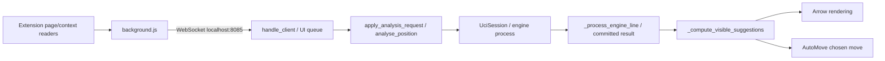

# Architecture / navigation

## Entry points and ownership

| File | Owns |
|---|---|
| `python/main.py` | Tk entry point and welcome dialog |
| `python/gui_overlay.py` / `ChessOverlay` | Shared application state; bridge queue; analysis orchestration; committed suggestions; rendering; settings integration |
| `python/control_panel.py` / `ControlPanel` | Sidebar, cards, Tk variables, control callbacks and synchronization |
| `python/engine_session.py` / `UciSession` | Per-process UCI negotiate → stop/ack → configure → ready → search |
| `python/engine_pool.py` | Process/socket helpers, result cache and command queue |
| `python/adaptive_policy.py` | Strict candidate choice, legal PV continuation memory, context allowlist |
| `python/recommendation_policy.py` | Move estimate formula and provable immediate draw helper |
| `python/depth_timer.py` | Thread-safe search tickets, timing summaries, match reset model |
| `python/settings_store.py` | Immutable JSON snapshots, coalescing and atomic background writes |
| `python/auth_utils.py` | Existing login/auth helpers and shared Windows capture/taskbar APIs |
| `python/automove.py` | Move timing and input execution; does not own recommendation ranking |
| `python/book_manager.py` | Polyglot book lookup, explorer/tablebase clients |
| `python/eval_window.py`, `pgn_analyzer.py`, `analysis_helpers.py` | PGN/evaluation UI and grading helpers |
| `python/widgets.py`, `modern_widgets.py` | Shared native Tk controls |
| `python/humanizer.py` | Opponent prediction helper; not own-side move selection |
| `python/arrow_diagnostics.py` | Bounded diagnostics around arrow failures |
| `python/version.py` | Desktop display version |

## Position-to-suggestion path

Use `navigate.py feature analysis`, `accuracy`, `arrows` and `automove` for live
function locations. `info depth` telemetry may update while result publication is
still gated. Do not bypass that gate in a renderer or input consumer.

## Extension boundary

`extension/manifest.json` declares script worlds/order. `fenProvider.js` reads the
page's board in the MAIN world; `mainListener.js` relays board data and isolated
content logic; `gameContext.js` supplies metadata helpers; `background.js` retains
latest board snapshots and manages the Python socket; `popup.js` reports status.
Use `navigate.py feature bridge`, then `rg -n '<message type>' extension python`.
No JS AST/call graph is claimed by the Python navigator.

## UI / thread boundary

Tk control variables and canvas operations belong on the Tk thread. Reader/socket
threads feed `ui_queue`; `poll_ui_queue` applies queued work. The main visualizer
and control panel are separate native windows. Arrows have a third click-through
window: parent capture protection does not cover its top-level HWND.

## Adding or moving code

Prefer a small independently testable module for new pure logic. Avoid moving
thousands of shared-state methods as a cosmetic change. Update all call sites,
feature anchors, relevant contracts and checks when extracting a method. New UI
settings cross defaults → load → widget → callback → save → synchronization.
